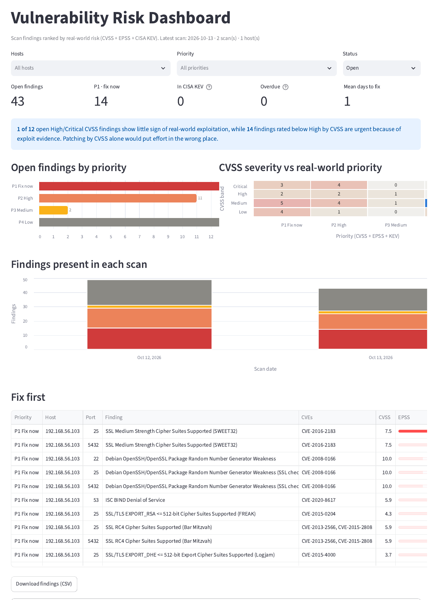

# Vulnerability Risk Prioritiser

Ranks vulnerability scan findings by **real-world risk** instead of CVSS alone, tracks them across repeated scans, and shows the results in a dashboard.

<!-- Add your live link here once deployed: **[Live dashboard](https://YOUR-APP-LINK.streamlit.app)** -->



## The problem

A typical scan returns hundreds of findings, and teams usually patch in CVSS order, Critical first. But CVSS measures how bad a vulnerability *could* be, not whether anyone is actually exploiting it. Most high-CVSS vulnerabilities are never exploited, while some medium-rated ones are used in real attacks and ransomware campaigns.

This tool adds two sources of real-world evidence to every finding:

- **EPSS** (FIRST.org): the probability a CVE will be exploited in the next 30 days, updated daily.
- **CISA KEV**: the US government's catalogue of vulnerabilities confirmed as exploited in the wild.

It combines them with CVSS and asset context into a fix-first priority, a due date, and a reason a person can read.

## What it does

1. **Reads scanner results** from Nessus (HTML report, `.nessus` or CSV) or OpenVAS (CSV), merging duplicate rows and dropping informational results.
2. **Enriches each CVE** with EPSS scores and CISA KEV status, including whether the CVE has been used in ransomware campaigns. Results are cached so repeat runs are fast and work offline. If a live lookup fails, the EPSS and KEV notes inside the Nessus report are used instead.
3. **Assigns a priority** (P1 to P4) with a plain-English reason. Hosts marked internet-facing or business-critical are raised one level.
4. **Tracks findings across scans**: first seen, fixed date, age, SLA due date, overdue, and days to fix.
5. **Reports**: an Excel workbook (also ready for Power BI), CSV files, a summary, and a Streamlit dashboard.

### Priority rules

| Priority | Rule | Fix within |
|---|---|---|
| **P1 Fix now** | In CISA KEV, or EPSS ≥ 50% | 7 days |
| **P2 High** | EPSS ≥ 10%, or CVSS ≥ 9.0 with EPSS ≥ 1% | 30 days |
| **P3 Medium** | CVSS ≥ 7.0, or EPSS ≥ 1% | 90 days |
| **P4 Low** | Everything else | 180 days |

All the thresholds are in `src/scoring.py`, so they're easy to review and change.

## Results from my lab

I scanned a deliberately vulnerable lab VM (Metasploitable 2) with Nessus Essentials on an isolated host-only network. Then I fixed the top findings and rescanned the next day. See [docs/LAB_SETUP.md](docs/LAB_SETUP.md) and [docs/REMEDIATION_LOG.md](docs/REMEDIATION_LOG.md).

| Metric | Baseline (12 Oct) | After fixes (13 Oct) |
|---|---|---|
| Open findings (per host and port) | 49 | 43 |
| Open P1 / P2 / P3 / P4 | 15 / 14 / 2 / 18 | 14 / 11 / 2 / 16 |
| Open Critical CVSS findings | 10 | 7 |
| Open findings in CISA KEV | 1 | 0 |
| Findings fixed | | 6 (all within SLA, average 1 day) |

**Prioritisation:** On the baseline scan, patching in CVSS order would have missed 6 of the 10 riskiest findings. 14 findings rated only Medium or Low by CVSS were urgent because of exploit evidence. For example, the FREAK export-cipher weakness has a CVSS of 4.3 but a 99% EPSS score.

**Remediation:** I fixed the findings that were exploitable right away and could be fixed with a configuration change:

- **Ghostcat** (P1, in CISA KEV): disabled Tomcat's AJP connector.
- **Bind-shell backdoor:** disabled it in the inetd config.
- **VNC with the password "password":** stopped the VNC server.
- **rlogin and Telnet:** disabled them in the inetd config.

Stopping VNC also closed an exposed X server. The rescan confirmed all 6 findings as fixed, and nothing in CISA KEV is left open.

**What I learned:** The first attempt to disable the backdoor and rlogin *looked* successful but wasn't. A port check showed those services were run by **xinetd**, not inetd. Verifying every fix, rather than assuming, is what caught it.

**Still open:** old TLS/SSL settings, Samba and BIND issues, and an end-of-life OS. These need upgrades this intentionally vulnerable VM can't take, so in a real environment they would get a risk exception with an owner and a review date.

## Run it yourself

```bash
git clone https://github.com/vinayappajigowda/vuln-risk-prioritiser.git
cd vuln-risk-prioritiser
python -m venv .venv
.venv\Scripts\activate            # Mac/Linux: source .venv/bin/activate
pip install -r requirements.txt

# 1. Put Nessus (.html/.nessus/.csv) or OpenVAS (.csv) results in data/scans/  (see docs/LAB_SETUP.md)
# 2. Optional: copy data/assets.example.csv to data/assets.csv and edit it
python prioritise.py

# 3. Open the dashboard
streamlit run app.py

# Tests
python -m pytest
```

`prioritise.py` writes these files to `outputs/`:

| File | Contents |
|---|---|
| `findings.csv` | Every finding with priority, reason, EPSS, KEV, status and SLA dates, in fix-first order |
| `vulnerability_report.xlsx` | Sheets: open findings (fix first), all findings, CVSS vs risk, trend, summary |
| `trend.csv` | Findings per priority in each scan |
| `summary.json` | Headline numbers |

**Power BI (optional):** Get Data > Text/CSV > `outputs/findings.csv`. Useful visuals: a card for open P1 findings, a bar of open findings by priority, a matrix of `cvss_band` against `tier`, and a line of `trend.csv` over `scan_date`.

## Design decisions

- **Exploit evidence over severity.** KEV and EPSS can raise a medium-CVSS finding to P1. High CVSS with no exploit activity stays P3, which is still tracked, just not first.
- **Explainable rules instead of a black-box score.** Every finding carries the reason for its priority, so an engineer can see why they're being asked to fix it now.
- **Asset context.** The same vulnerability matters more on an internet-facing server than on an isolated test box.
- **No CVE doesn't mean no risk.** Backdoors, default passwords and end-of-life software often have no CVE, so EPSS and KEV can't score them. Critical findings without a CVE go to P2 for manual review instead of sinking to the bottom.
- **Honest about missing data.** If EPSS can't be fetched, the reason says "no EPSS data" rather than treating it as low risk, and the tool prints a warning.
- **Lifecycle tracking.** A finding is marked fixed when it disappears from the next scan of the same host. That gives time to fix and SLA compliance, which are the numbers vulnerability management teams report on.

## Limitations and next steps

- A finding missing from a later scan is assumed fixed. It could also be a scan that failed to reach the host, so a real process would confirm fixes with a targeted retest.
- EPSS is a probability, not a certainty, and KEV only lists confirmed exploitation, so new attacks may not be in either yet.
- Findings without a CVE (such as misconfigurations) are prioritised on CVSS only.
- **Next:**
  - Pull scans straight from the Nessus API
  - Create ServiceNow or Jira tickets for P1 findings
  - Alert when a CVE in your environment is newly added to KEV

## Project structure

```
prioritise.py        Command-line tool: load, enrich, prioritise, track, export
app.py               Streamlit dashboard
src/parsers.py       Nessus (HTML report, .nessus, CSV) and OpenVAS (CSV) readers
src/enrich.py        EPSS and CISA KEV lookups, with caching
src/scoring.py       Priority rules, reasons and risk score
src/history.py       First seen, fixed, SLA, days to fix, trend
src/report.py        Summary, CVSS-vs-risk comparison, CSV and Excel export
docs/LAB_SETUP.md    How to build the lab and get real scan data
tests/               14 pytest tests on made-up scan exports (EPSS/KEV mocked)
```

## Data sources

- [EPSS](https://www.first.org/epss/) by FIRST.org
- [CISA Known Exploited Vulnerabilities Catalog](https://www.cisa.gov/known-exploited-vulnerabilities-catalog)

---

Built by **Vinay Appajigowda** · [LinkedIn](https://www.linkedin.com/in/vinay-appajigowda-822aa3206/) · [GitHub](https://github.com/vinayappajigowda)
